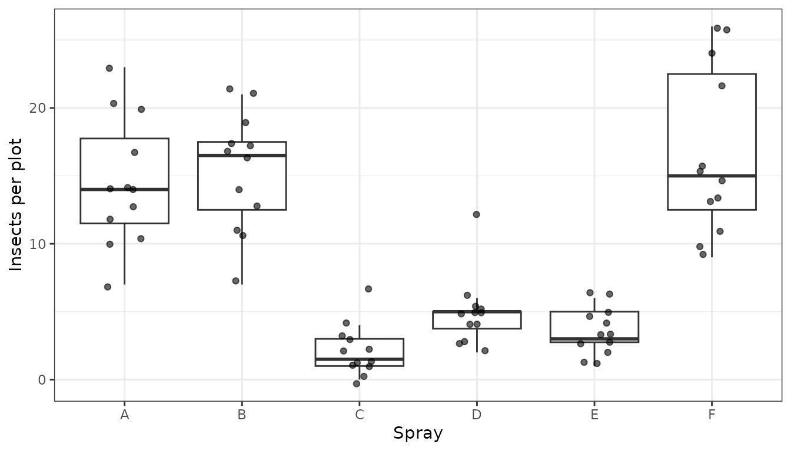

# Comparing treatments with counts

**The study.** Insects were counted on agricultural plots treated with
one of six sprays, twelve plots per spray (`InsectSprays`; Beall 1942).
**The question:** do the sprays differ in how many insects survive?

``` r

library(tidyvisor)
```

## 1. Look at the data

``` r

library(ggplot2)
ggplot(InsectSprays, aes(spray, count)) +
  geom_boxplot(outlier.shape = NA) +
  geom_jitter(width = 0.15, alpha = 0.6) +
  labs(x = "Spray", y = "Insects per plot") +
  theme_bw()
```



The sprays with few insects also have little spread: the variance grows
with the mean, as it does for counts.

## 2. Ask which test

``` r

tidyvisor(InsectSprays, response = "count", group = "spray")
#> Registered S3 method overwritten by 'parsnip':
#>   method          from 
#>   print.nullmodel vegan
#> 
#> ── tidyvisor: which analysis? ──────────────────────────────────────────────────
#> Question: compare
#> 
#> ── What the data show ──
#> 
#> • Groups: 6 — A (n = 12), B (n = 12), C (n = 12), D (n = 12), E (n = 12), F (n
#>   = 12)
#> • Normality (Shapiro-Wilk p, per group): A 0.75; B 0.64; C 0.048; D 0.0027; E
#>   0.3; F 0.1 — at least one group departs from normality
#> • Skewness: A 0.27; B -0.35; C 1.13; D 1.68; E 0.05; F 0.39 — right-skewed
#>   (long tail of large values)
#> • Outliers (robust z > 3.5): 0
#> • Spread (largest SD / smallest SD): 3.59 (Fligner-Killeen p = 0.013) — unequal
#>   spreads: Student's t and the classical ANOVA are unreliable, especially with
#>   unequal group sizes
#> • Counts: non-negative whole numbers — counts have a variance that grows with
#>   the mean; a GLM for counts models that directly
#> • All values positive: no
#> 
#> ── Recommended ──
#> 
#> Before testing: Plot the data
#> Box plots with the points show skewness, outliers and unequal spread at a
#> glance; the checks above put numbers on them.
#> boxplot(count ~ spray, data = data); stripchart(count ~ spray, data = data, vertical = TRUE, add = TRUE, method = "jitter")
#> Test: GLM for counts: negative binomial
#> The response is counts whose spread differs between groups. A count GLM models
#> that directly and gives each group difference as a ratio of means; transforming
#> counts (log(y + 1)) biases the estimates (O'Hara and Kotze 2010). The variance
#> is up to 2.3 times the mean, so the negative binomial.
#> m <- MASS::glm.nb(count ~ spray, data = data)
#> anova(m, test = "Chisq"); tidyvisor(m)
#> Alternative: Non-parametric: rank test
#> Makes no assumption about the shape of the distributions; answers whether
#> values in one group tend to be larger.
#> kruskal.test(count ~ spray, data = data)
#> pairwise.wilcox.test(data$count, data$spray, p.adjust.method = "holm")
#> Alternative: Robust: trimmed means
#> Resists outliers and heavy tails while still comparing a centre.
#> WRS2::t1way(count ~ spray, data = data)   # 20% trimmed means
#> Interpret: Plain-language explanation of the result
#> What was tested, the effect with its interval, and what to do next.
#> tidyvisor(result)
```

The checks confirm what the plot shows: skewed groups, a more than
threefold difference in spread, and counts. A one-way ANOVA would be
unreliable; tidyvisor recommends a count model, with a rank test and a
robust test as alternatives.

## 3. What an ANOVA would have said

``` r

a <- lm(count ~ spray, data = InsectSprays)
tidyvisor(a)$sections[c("Diagnostics", "What to do next")]
#> $Diagnostics
#> [1] "Normality of residuals (Shapiro-Wilk): W = 0.960, p = 0.022; the residuals depart from normality: look at the Q-Q plot, and consider a transformation or another family."                        
#> [2] "Constant variance (Breusch-Pagan): chi-squared = 20.70 on 5 df, p < 0.001; the spread of the residuals changes with the fitted values: consider a log or Gamma model, or robust standard errors."
#> [3] "Influence: no observation dominates the fit (largest Cook's distance 0.09, row 69; values above 1 would be a concern)."                                                                          
#> 
#> $`What to do next`
#> [1] "count is counts: fit a Poisson or negative binomial GLM instead of a linear model (glm(..., family = poisson) or MASS::glm.nb()); it models the variance growing with the mean. Avoid log(y + 1), which biases the estimates (O'Hara and Kotze 2010)."
#> [2] "After any change, check the residuals again with plot() and tidyvisor()."
```

## 4. The count model

``` r

nb <- MASS::glm.nb(count ~ spray, data = InsectSprays)
tidyvisor(nb)
#> 
#> ── tidyvisor: what the results show ────────────────────────────────────────────
#> 
#> ── Overview ──
#> 
#> • Generalised linear model of count on 72 observations (Negative
#>   Binomial(28.0995) family, log link).
#> 
#> ── Fit ──
#> 
#> • The predictors explain 76.3% of the deviance (the GLM analogue of R-squared).
#> • Against a model with no predictors: F = 42.06 on 5 and 66 df, p < 0.001.
#> 
#> ── Effects ──
#> 
#> • sprayB: spray = B (compared with spray = A) multiplies the expected count by
#>   1.06 (+6%; 95% CI 0.814 to 1.37), p = 0.669.
#> • sprayC: spray = C (compared with spray = A) multiplies the expected count by
#>   0.144 (-86%; 95% CI 0.0913 to 0.226), p < 0.001.
#> • sprayD: spray = D (compared with spray = A) multiplies the expected count by
#>   0.339 (-66%; 95% CI 0.242 to 0.475), p < 0.001.
#> • sprayE: spray = E (compared with spray = A) multiplies the expected count by
#>   0.241 (-76%; 95% CI 0.166 to 0.352), p < 0.001.
#> • sprayF: spray = F (compared with spray = A) multiplies the expected count by
#>   1.15 (+15%; 95% CI 0.888 to 1.49), p = 0.281.
#> • Effects on the log or logit scale are multiplicative: they combine by
#>   multiplying, and a factor of 1 means no effect.
#> • Each effect is estimated with the other predictors held fixed.
#> 
#> ── Diagnostics ──
#> 
#> • Influence: no observation dominates the fit (largest Cook's distance 0.18,
#>   row 27; values above 1 would be a concern).
#> 
#> ── After the overall test ──
#> 
#> • spray (6 levels) has an overall effect (p < 0.001): the levels are not all
#>   alike. Go on to post hoc comparisons of every pair, adjusted for the number
#>   of comparisons; the coefficients above only compare each level with the
#>   reference level A.
#> • emmeans::emmeans(m, pairwise ~ spray, type = "response") # Tukey-adjusted
#>   pairs, with intervals
#> • If only comparisons with a control matter, decide so before looking and use
#>   emmeans::emmeans(m, trt.vs.ctrl ~ spray, type = "response") (Dunnett; the
#>   first level, A, is the control), which keeps more power.
#> 
#> ── For the paper ──
#> 
#> • Results (strongest evidence first; each factor level is compared with the
#>   reference level):
#> • 'count was 0.144 times as high for spray = C as for spray = A (95% CI 0.0913
#>   to 0.226, p < 0.001).'
#> • 'count was 0.241 times as high for spray = E as for spray = A (95% CI 0.166
#>   to 0.352, p < 0.001).'
#> • 'count was 0.339 times as high for spray = D as for spray = A (95% CI 0.242
#>   to 0.475, p < 0.001).'
#> • The model is on the log scale, so effects are reported as ratios of means
#>   (exponentiated coefficients) with their intervals.
#> • Report every term of the model, not only the significant ones, with the
#>   estimate, its 95% CI and the p-value; give n, and the fit (R-squared, or
#>   deviance explained, or the random-effect SDs for a mixed model).
#> • Figure: model predictions with their confidence band over the raw data, one
#>   panel per focal predictor:
#> • ggeffects::ggpredict(m, terms = "spray") |> plot(show_data = TRUE)
#> • ggplot2::ggsave("figure1.pdf", width = 85, height = 70, units = "mm") # one
#>   journal column
#> • Figure style for journals: show the raw data with the estimates, give n per
#>   group in the caption, label axes with units, use a colour-blind-safe palette
#>   (Okabe-Ito, viridis) and no 3D, pie or dual-axis charts; text at least 8 pt
#>   at final size; save as PDF or SVG (vector) at the journal's column width
#>   (about 85 mm single, 180 mm double), or 600 dpi for raster images.
#> • Table: one row per term with the estimate, 95% CI and p-value (and the
#>   random-effect SDs for a mixed model):
#> • gtsummary::tbl_regression(m, exponentiate = TRUE) # or broom::tidy(m,
#>   conf.int = TRUE, exponentiate = TRUE) for your own table
#> • Methods: the model formula, the family and link, how the model was checked,
#>   the software and packages with versions (R 4.6.2; citation("stats")), and how
#>   the predictors were chosen (before seeing the data, or how).
#> 
#> ── Reading the plots ──
#> 
#> • plot(model) shows four diagnostics: residuals against fitted values (look for
#>   curves or a funnel), the normal Q-Q plot, scale-location (spread against
#>   fitted values) and residuals against leverage (influential points).
#> • Plot each effect on the response scale, with its confidence band, rather than
#>   the coefficients alone.
```

Each spray’s effect is now a **ratio** of mean counts relative to spray
A, with its confidence interval: the natural way to report a treatment
that reduces pests by a fraction.

## 5. A check with a rank test

``` r

tidyvisor(kruskal.test(count ~ spray, data = InsectSprays))
#> 
#> ── tidyvisor: what the results show ────────────────────────────────────────────
#> 
#> ── Overview ──
#> 
#> • Kruskal-Wallis rank sum test on count by spray.
#> 
#> ── Result ──
#> 
#> • Kruskal-Wallis chi-squared = 54.7 (df = 5), p < 0.001.
#> 
#> ── Meaning ──
#> 
#> • Values in one group tend to be larger than in another. Rank tests compare
#>   whole distributions, not means: report medians or the location shift with its
#>   interval, not a difference in means.
#> • A p-value is not the size of an effect: always report the estimate and its
#>   interval, and a non-significant result is not evidence of no difference.
#> 
#> ── After the overall test ──
#> 
#> • The overall test shows that the 6 groups are not all alike; it does not say
#>   which differ. Go on to post hoc comparisons of every pair, with p-values
#>   adjusted for the number of comparisons.
#> • Rank-based pairs (the follow-up to Kruskal-Wallis):
#>   pairwise.wilcox.test(data$count, data$spray, p.adjust.method = "holm"), or a
#>   Dunn test (FSA::dunnTest(count ~ spray, data = data, method = "holm")).
#> • Report each pair as a median difference or Hodges-Lehmann shift with its
#>   interval (wilcox.test(conf.int = TRUE)), not only adjusted p-values.
#> • Decide which pairs matter before looking: if only comparisons with a control
#>   are of interest, test those alone (Dunnett, or Holm on that smaller set);
#>   fewer comparisons keep more power.
#> 
#> ── What to do next ──
#> 
#> • For an effect size, wilcox.test(conf.int = TRUE) gives the Hodges-Lehmann
#>   shift with its interval.
#> • If the data are positive and right-skewed, a test on the log scale (or a
#>   Gamma GLM) gives a ratio of means, which is often easier to report.
#> 
#> ── For the paper ──
#> 
#> • Results: 'count differed among levels of spray (Kruskal-Wallis rank sum test;
#>   H(5) = 54.7, p < 0.001).'
#> • Report the statistic with its degrees of freedom, the exact p-value (p <
#>   0.001 below that), and the effect size with its interval; never 'p = 0.000'
#>   or 'n.s.' alone.
#> • Figure:
#> • ggplot2::ggplot(data, ggplot2::aes(spray, count)) +
#>   ggplot2::geom_boxplot(outlier.shape = NA, width = 0.5) +
#>   ggplot2::geom_jitter(width = 0.15, alpha = 0.6) +
#>   ggplot2::theme_classic(base_size = 9)
#> • ggplot2::ggsave("figure1.pdf", width = 85, height = 70, units = "mm") # one
#>   journal column
#> • Figure style for journals: show the raw data with the estimates, give n per
#>   group in the caption, label axes with units, use a colour-blind-safe palette
#>   (Okabe-Ito, viridis) and no 3D, pie or dual-axis charts; text at least 8 pt
#>   at final size; save as PDF or SVG (vector) at the journal's column width
#>   (about 85 mm single, 180 mm double), or 600 dpi for raster images.
#> • Table: one row per level of spray with n and the median and interquartile
#>   range; the test in a footnote, and any post hoc results as letters or a
#>   pairwise table with adjusted p-values.
#> • Methods: name the test (Kruskal-Wallis rank sum test), the software and
#>   version (R 4.6.2, citation()), any adjustment for multiple comparisons, and
#>   the significance level.
```

Both analyses agree that the sprays differ; the count model also says by
how much.

## 6. Report

> Insect counts were compared among the six sprays with a negative
> binomial generalised linear model
> ([`MASS::glm.nb()`](https://rdrr.io/pkg/MASS/man/glm.nb.html)),
> because the counts were overdispersed and their variance increased
> with the mean, which ruled out a one-way ANOVA. Effects are reported
> as ratios of mean counts relative to spray A with 95% confidence
> intervals; a Kruskal-Wallis test gave the same conclusion.

## References

Beall, G. (1942). The transformation of data from entomological field
experiments so that the analysis of variance becomes applicable.
*Biometrika* 32, 243-262.

O’Hara, R. B. and Kotze, D. J. (2010). Do not log-transform count data.
*Methods in Ecology and Evolution* 1, 118-122.
