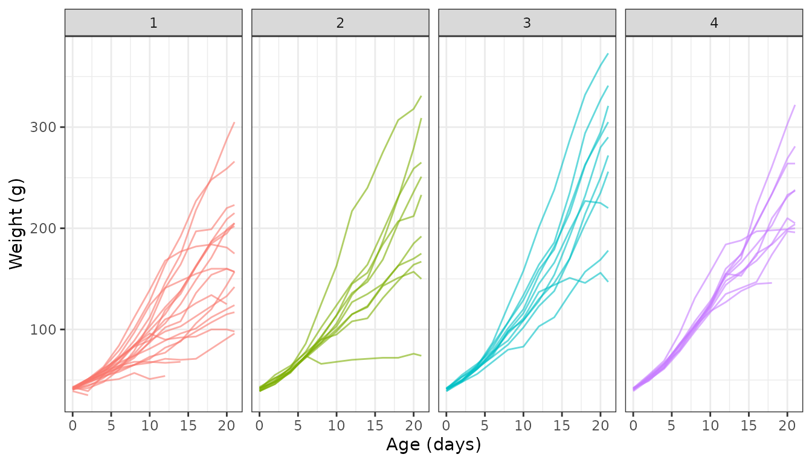

# A diet experiment, from plan to report

**The study.** Fifty chicks were fed one of four diets and weighed every
few days from birth to day 21 (`ChickWeight`, from Crowder and Hand
1990). **The question:** do the diets differ in how fast chicks grow?

``` r

library(tidyvisor)
```

## 1. Plan

Before the experiment, tidyvisor lists the good practice for an
experiment:

``` r

tv_practice("plan", design = "experiment")$advice[, c("step", "recommendation")]
#> # A tibble: 5 × 2
#>   step  recommendation                                              
#>   <chr> <chr>                                                       
#> 1 Plan  Write the question and the hypothesis before collecting data
#> 2 Plan  Define the unit of replication                              
#> 3 Plan  Run a power analysis                                        
#> 4 Plan  Randomise, include controls and blind where possible        
#> 5 Plan  Pre-register the study and the analysis plan
```

How many chicks per diet? Suppose a difference of 40 g at day 21 matters
and the standard deviation between chicks is about 50 g:

``` r

tv_power("two_groups", delta = 40, sd = 50)
#> 
#> ── tidyvisor: how many samples? ────────────────────────────────────────────────
#> Question: power
#> 
#> ── What the data show ──
#> 
#> • Design: two_groups
#> • Effect to detect: difference 40.0 with SD 50.0 (Cohen's d = 0.80)
#> • Power, significance level: 80%, 0.05
#> • Needed: 26 samples per group (52 in total)
#> • If the effect is half as large: 100 samples per group
#> • If it is twice as large: 8 samples per group
#> • For 90% power: 34 samples per group
#> 
#> ── Recommended ──
#> 
#> Sample size: Collect at least 26 samples per group (52 in total)
#> Gives an 80% chance of detecting difference 40.0 with SD 50.0 (Cohen's d =
#> 0.80) at the 0.05 level; with fewer, a real effect of that size will often be
#> missed and a non-significant result will say little.
#> power.t.test(delta = 40, sd = 50, power = 0.8, sig.level = 0.05)
#> Before the field: Add a margin for losses
#> Traps fail, plots flood and samples are lost: collect 10-20% more than the
#> minimum. Randomise which units get each treatment, and record the site and date
#> of every sample.
#> Check: The effect size drives everything
#> Halving the effect roughly quadruples the sample size (see the checks). Use the
#> smallest effect that would matter biologically, from the literature or a pilot,
#> and report the power analysis with the study.
```

## 2. Audit the data

``` r

tidyvisor(ChickWeight, question = "design", response = "weight",
          group = "Diet", unit = "Chick", time = "Time")
#> Registered S3 method overwritten by 'parsnip':
#>   method          from 
#>   print.nullmodel vegan
#> 
#> ── tidyvisor: is the design sound? ─────────────────────────────────────────────
#> Question: design
#> 
#> ── What the data show ──
#> 
#> • Rows and columns: 578 rows, 4 columns
#> • Missing values: none
#> • Duplicated rows: 0
#> • Response: whole numbers, large: probably a measurement rounded to whole units
#>   — If these are counts, use a Poisson or negative binomial model; if a
#>   measurement, a linear model (or Gamma for positive skewed values).
#> • Groups: 4 — 1 (220), 2 (120), 3 (120), 4 (118)
#> • Units: 50 units, 11.6 rows per unit — several measurements per unit: they are
#>   not independent
#> • Unit of replication: Chick (treatment applied to whole units) — true
#>   replicates (Chicks) per group: Diet 1: 20, Diet 2: 10, Diet 3: 10, Diet 4:
#>   10; not the number of rows
#> • Time points: 12 — repeated over time: residuals may be autocorrelated
#> 
#> ── Recommended ──
#> 
#> Design: Treat Chick as the unit of replication
#> Each Chick received one treatment, so its 11.6 measurements are
#> pseudoreplicates (Hurlbert 1984). Analyse with a random effect for Chick, or
#> average within each Chick; counting rows as replicates makes p-values far too
#> small.
#> Design: Allow for correlation over time
#> Measurements close in time are more alike; check the autocorrelation of the
#> residuals and, if needed, add a temporal correlation structure (nlme::corAR1(),
#> glmmTMB::ar1()).
#> acf(residuals(m))
#> Analysis: Mixed model
#> Chosen from the kind of response and the structure of the design; ask tidyvisor
#> for the detailed advice and the assumption checks.
#> lme4::lmer(weight ~ Diet + Time + (1 | Chick), data = data)
#> # detailed advice: tidyvisor(data, response = "weight", random = "Chick")
#> Next: Good practice for the rest of the study
#> Pre-registration, data management, effect sizes and reporting guidelines.
#> tv_practice()
```

The audit finds what matters most: the **chick**, not the row, is the
unit of replication. There are 50 replicates, not 578, and the design is
unbalanced (20 chicks on diet 1, 10 on the others).

## 3. Look at the data

``` r

library(ggplot2)
ggplot(ChickWeight, aes(Time, weight, group = Chick, colour = Diet)) +
  geom_line(alpha = 0.6) +
  facet_wrap(~ Diet, nrow = 1) +
  labs(x = "Age (days)", y = "Weight (g)") +
  theme_bw() + theme(legend.position = "none")
```



Growth curves fan out: chicks differ in growth rate, and the spread
grows with age.

## 4. Analyse

A mixed model with a random intercept and slope for each chick lets each
grow at its own rate, and tests whether diets change the average rate
(the diet-by-time interaction).

``` r

tidyvisor(ChickWeight, response = "weight", predictors = c("Time", "Diet"),
          random = "Chick")
#> 
#> ── tidyvisor: which analysis? ──────────────────────────────────────────────────
#> Question: mixed
#> 
#> ── What the data show ──
#> 
#> • Observations: 578
#> • Response: counts (non-negative integers)
#> • Variance / mean: 41.5 — above 1: overdispersed; a negative binomial model is
#>   safer than Poisson
#> • Zeros: 0% observed, 0% expected under Poisson
#> • Parameters (excluding intercept): 4
#> • Levels of Chick: 50 (observations per level: 2 to 12, median 12)
#> 
#> ── Recommended ──
#> 
#> Model: Generalised linear mixed model (lme4)
#> Observations in the same group are not independent; random intercepts for Chick
#> account for it and let the results generalise to other groups (Bolker et al.
#> 2009). The counts are overdispersed, so the negative binomial is used.
#> m <- lme4::glmer.nb(weight ~ Time + Diet + (1 | Chick), data = data)
#> Random slopes: Consider a random slope for a predictor that varies within
#> groups
#> If the effect of a predictor differs among groups, a random intercept alone
#> makes its p-value too small.
#> (1 + Time | Chick)
#> Before fitting: Plot the response against each predictor
#> Shows non-linear relations, outliers and interactions that the model would miss
#> (Zuur et al. 2010).
#> plot(data[c("weight", "Time", "Diet")])
#> After fitting: Check the residuals
#> Residual plots show non-linearity, unequal variance and influential points;
#> tidyvisor reports the tests.
#> plot(m)   # or performance::check_model(m)
#> Interpret: Plain-language explanation of the model
#> Fixed effects on the scale of the response, random-effect variances and
#> diagnostics.
#> tidyvisor(m)
```

``` r

m <- lme4::lmer(weight ~ Time * Diet + (Time | Chick), data = ChickWeight)
tidyvisor(m)
#> 
#> ── tidyvisor: what the results show ────────────────────────────────────────────
#> 
#> ── Overview ──
#> 
#> • Linear mixed model of weight on 578 observations in 50 levels of Chick
#>   (gaussian family, identity link), fitted with lme4.
#> 
#> ── Random effects ──
#> 
#> • Chick: (Intercept) varies with a standard deviation of 10.8 (in units of
#>   weight).
#> • Chick: Time varies with a standard deviation of 3.30 (in units of weight).
#> • Residual standard deviation 12.8. Intra-class correlation 0.42: 42% of the
#>   variance left after the fixed effects lies between groups.
#> 
#> ── Effects ──
#> 
#> • Time: each one-unit increase in Time changes weight by 6.28 (95% CI 4.78 to
#>   7.77), p < 0.001.
#> • Diet2: Diet = 2 (compared with Diet = 1) changes weight by -5.03 (95% CI
#>   -14.8 to 4.79), p = 0.316.
#> • Diet3: Diet = 3 (compared with Diet = 1) changes weight by -15.4 (95% CI
#>   -25.2 to -5.59), p = 0.002.
#> • Diet4: Diet = 4 (compared with Diet = 1) changes weight by -1.75 (95% CI
#>   -11.6 to 8.08), p = 0.727.
#> • Time:Diet2: each one-unit increase in Time:Diet2 changes weight by 2.33 (95%
#>   CI -0.224 to 4.89), p = 0.074.
#> • Time:Diet3: each one-unit increase in Time:Diet3 changes weight by 5.15 (95%
#>   CI 2.59 to 7.70), p < 0.001.
#> • Time:Diet4: each one-unit increase in Time:Diet4 changes weight by 3.25 (95%
#>   CI 0.697 to 5.81), p = 0.013.
#> • lmer() gives no p-values; those shown use the normal approximation (Wald z),
#>   which is optimistic with few groups. For small samples, use lmerTest or a
#>   parametric bootstrap.
#> • Fixed effects are for a typical group (random effects at zero), with the
#>   other predictors held fixed.
#> 
#> ── Diagnostics ──
#> 
#> • Normality of residuals (Shapiro-Wilk): W = 0.987, p < 0.001; inspect the Q-Q
#>   plot; mixed models are fairly robust to mild departures.
#> 
#> ── After the overall test ──
#> 
#> • Diet interacts with Time (Time:Diet, p = 0.001): its effect depends on Time,
#>   so compare the levels of Diet within each level of Time, not averaged over
#>   them.
#> • emmeans::emmeans(m, pairwise ~ Diet | Time) # Tukey-adjusted pairs within
#>   each level
#> 
#> ── For the paper ──
#> 
#> • Results (strongest evidence first; each factor level is compared with the
#>   reference level):
#> • 'weight changed by 6.28 per unit increase in Time (95% CI 4.78 to 7.77, p <
#>   0.001).'
#> • 'weight changed by 5.15 per unit increase in Time:Diet3 (95% CI 2.59 to 7.7,
#>   p < 0.001).'
#> • 'weight was 15.4 lower for Diet = 3 than for Diet = 1 (95% CI -25.2 to -5.59,
#>   p = 0.002).'
#> • Report every term of the model, not only the significant ones, with the
#>   estimate, its 95% CI and the p-value; give n, and the fit (R-squared, or
#>   deviance explained, or the random-effect SDs for a mixed model).
#> • Figure: model predictions with their confidence band over the raw data, one
#>   panel per focal predictor:
#> • ggeffects::ggpredict(m, terms = "Time") |> plot(show_data = TRUE)
#> • ggplot2::ggsave("figure1.pdf", width = 85, height = 70, units = "mm") # one
#>   journal column
#> • Figure style for journals: show the raw data with the estimates, give n per
#>   group in the caption, label axes with units, use a colour-blind-safe palette
#>   (Okabe-Ito, viridis) and no 3D, pie or dual-axis charts; text at least 8 pt
#>   at final size; save as PDF or SVG (vector) at the journal's column width
#>   (about 85 mm single, 180 mm double), or 600 dpi for raster images.
#> • Table: one row per term with the estimate, 95% CI and p-value (and the
#>   random-effect SDs for a mixed model):
#> • gtsummary::tbl_regression(m) # or broom.mixed::tidy(m, conf.int = TRUE) for
#>   your own table
#> • Methods: the model formula, the family and link, how the model was checked,
#>   the software and packages with versions (R 4.6.2; citation("lme4")), and how
#>   the predictors were chosen (before seeing the data, or how).
#> 
#> ── Reading the plots ──
#> 
#> • Plot residuals against fitted values (look for curves or a funnel) and a Q-Q
#>   plot of the random effects (lattice::qqmath(lme4::ranef(m))).
#> • For generalised models, simulated residuals (DHARMa::simulateResiduals(m))
#>   are easier to read than raw residuals.
```

## 5. Report

A model paragraph, with the numbers from the output above:

> Chick weight was modelled with a linear mixed model with age, diet and
> their interaction as fixed effects, and a random intercept and slope
> for age for each chick (lme4; Bates et al. 2015), because each chick
> was weighed repeatedly and the chick was the unit of replication (50
> chicks). Diets changed the rate of growth: see the age-by-diet
> coefficients and their 95% confidence intervals in the table above.

## References

Bates, D., Mächler, M., Bolker, B. and Walker, S. (2015). Fitting linear
mixed-effects models using lme4. *Journal of Statistical Software*
67(1), 1-48.

Crowder, M. and Hand, D. (1990). *Analysis of Repeated Measures*.
Chapman and Hall.
